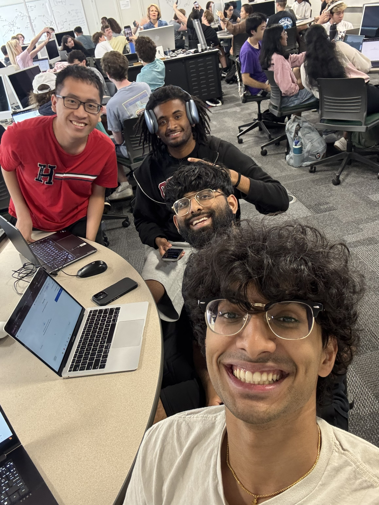

# Weekly Status Report

**Project Name: TheSpot**  
**Group Name: TheSpot**  
**Project Manager: Tri Vo**

---

## Group Selfie

Upload image to `/images/` and link it below:

---

## Progress Summary - **Week #1:** Monday, Oct 27 - Sunday, Nov 2

** What we completed this week:**

- We finished our mockup for the web design in Figma.

- ** Issues / blockers encountered:**
- I have trouble upload the pictures to GitHub due to technical issues.

- ** Goals for next week:**
- We will try to implement our Figma design inside of our actual project with code.
- ***

## Progress Summary - **Week #2:** Monday, Nov 3 - Sunday, Nov 9

** What we completed this week:**

- We started on implmentations of the front-end and engaged in group meetings

- ** Issues / blockers encountered:**
- The project was initialize incorrectly, so I have to transfer the code over to a newly made structure.

- ** Goals for next week:**
- We would like to finish the implementations of the front-end.

- ***

## Progress Summary - **Week #3:** Monday, Nov 10 - Sunday, Nov 16

** What we completed this week:**

- We finished implemented the front-end and the UI functionality.

- ** Issues / blockers encountered:**
- We have some trouble with using github like merging and pushing issues.

- ** Goals for next week:**
- We would like to integrate a database into our app.

- ***

## Progress Summary - **Final Week:** Monday, Nov 17 - Sunday, Nov 23

** What we completed this week:**
We completed the entire project this week.

-
- ** Issues / blockers encountered:**
  Accessing the map from Google was quite challenging.
-
- ** Video preparation plans:**
  I will be following the guidelines of the rubric for my video.
-
- ** Presentation preparation plans:**
- We planning some epic ideas to make our presentation great.
- ***
